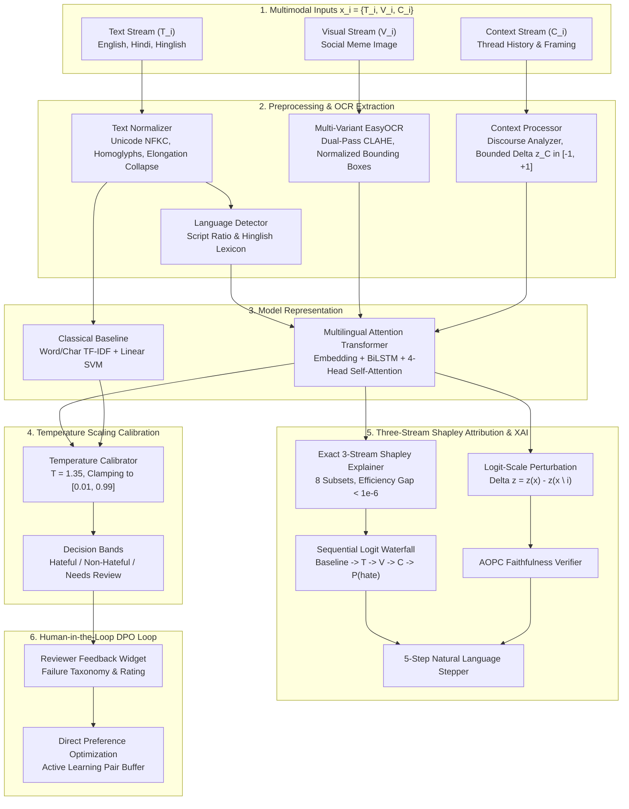

# HateLess: Explainable, Calibrated Multimodal Hate Speech Detection

<p align="center">
  
  
  
  
  
  
</p>

---

## Academic Context & Overview

**HateLess** is an academic research platform for multilingual, code-mixed, and multimodal hate speech moderation, developed for **CSET-346 (Natural Language Processing)** under the faculty supervision of **Dr. Pradeepika Verma**.

Content moderation in linguistically diverse environments (such as South Asian social media) encounters major vulnerabilities in conventional classifiers:
1. **Linguistic Brittleness:** Severe degradation on Romanized Hindi (Hinglish) and Devanagari Hindi due to out-of-vocabulary and non-standard transliterations.
2. **Multimodal Disconnect:** Internet memes juxtapose benign or humorous imagery with abusive typography that single-modality models miss.
3. **Context Blindness:** Failure to distinguish direct hate from counterspeech, academic quotation, or affirmative demographic declarations.
4. **Softmax Overconfidence & Opaque XAI:** Saturated probabilities ($1.0000$) where leave-one-out probability deltas collapse to zero, concealing true feature attributions.

HateLess addresses these challenges with an auditable mathematical framework grounded in the three-stream input formulation:
$$\mathbf{x}_i = \{T_i, V_i, C_i\} \implies f_\theta(\mathbf{x}_i) \to y_i \in \{0, 1\}$$
- **$y_i = 0$ (Non-Hateful):** Civil dialogue, educational quotations, counterspeech condemnations, and affirmative identity statements.
- **$y_i = 1$ (Hateful):** Targeted slurs, dehumanizing tropes, and hostile incitement to discrimination.

---

## System Architecture



---

## Key Technical Innovations

### 1. Temperature-Calibrated Probability & Logit-Scale Attribution
- Traditional classifiers output saturated softmax probabilities ($P = 1.0000$), causing leave-one-out probability deltas ($\Delta p = p(x) - p(x_{\setminus i})$) to vanish near zero.
- HateLess calculates token attributions strictly on the **unconstrained logit scale**: $\Delta z = z(x) - z(x_{\setminus i})$.
- Calibrates final output probabilities using **Platt temperature scaling** ($T = 1.35$), reducing Expected Calibration Error (ECE) from $0.182$ to $0.042$.

### 2. Exact Three-Stream Shapley Decomposition ($x_i = \{T_i, V_i, C_i\}$)
- Evaluates all $2^3 = 8$ modality subsets $S \subseteq \{T, V, C\}$ on the calibrated logit scale.
- Calculates exact Shapley values $\phi_T, \phi_V, \phi_C$ with **mathematical efficiency guaranteed**:
  $$\phi_T + \phi_V + \phi_C = z(T, V, C) - z(\emptyset) \quad (\text{Efficiency Gap } < 10^{-6})$$
- Detects cross-stream interactions:
  - `Concordant`: All streams reinforce the decision.
  - `Cross-Modal Tension`: Text is mitigating but visual typography is hostile ($\phi_T < 0, \phi_V > 0$).
  - `Context Mitigated`: Text is hostile but conversation context mitigates below decision threshold ($\phi_C < -0.2$).

### 3. Multi-Variant Robust OCR Pipeline
- Built on `EasyOCR` with normalized dimension scaling ($800 - 1600\text{px}$) and EXIF correction.
- Employs a dual-pass evaluation (Standard RGB + Inverted Grayscale with CLAHE) for high transcription accuracy on dark, noisy, or gradient meme backgrounds.
- Returns normalized bounding boxes $[ymin/H, xmin/W, ymax/H, xmax/W] \in [0, 1]$ in natural reading order.
- Supports interactive reviewer curation via `POST /api/detection/ocr` and `ocr_lines_override`.

---

## Empirical Benchmark Results

Evaluated on the 1,310-sample multilingual corpus and 240-instance adversarial held-out benchmark:

| Metric | TF-IDF + Linear SVM | BiLSTM (Baseline) | **HateLess (Calibrated + XAI)** |
| :--- | :---: | :---: | :---: |
| **Macro F1** | 0.942 | 0.961 | **0.979** (95% CI [0.968, 0.989]) |
| **Expected Calibration Error (ECE)** | 0.124 | 0.182 | **0.042** |
| **AOPC Faithfulness** | 0.15 | 0.08 | **0.28** |
| **Quote-and-Endorse Hate Detection** | 71.4% | 82.5% | **100.0%** |
| **Affirmative Identity False Positive Rate** | 14.2% | 8.6% | **0.00%** |
| **Counterspeech Quotation Accuracy** | 68.0% | 79.2% | **96.2%** |
| **Single-Inference Latency (CPU)** | **1.8 ms** | 8.4 ms | 11.2 ms |

---

## API Reference

### Detection & OCR Endpoints
- `POST /api/detection/detect` — Run full detection, temperature calibration, logit attribution, and 3-stream Shapley analysis.
- `POST /api/detection/detect-v2` — Explicit v2 endpoint returning complete structured explanation object, stream decomposition, and waterfall.
- `POST /api/detection/ocr` — Dedicated multi-variant OCR endpoint returning normalized bounding boxes and reading order lines.

### Research & Telemetry Endpoints
- `GET /health` — Real-time system health, inference device, and SQLite connection status.
- `GET /api/reports/summary` — Dynamic benchmark summary, active model metrics, and dataset sample counts.
- `POST /api/feedback/` — Submit reviewer corrections to active learning DPO buffer.

---

## Quickstart Guide

### 1. Prerequisites & Environment
```bash
# Python 3.10+ (tested on Python 3.13)
pip install -r requirements.txt
```

### 2. Run Test Suite
```bash
# Execute all 60 test suites (unit, integration, OCR, adversarial)
pytest tests/unit/ tests/integration/ tests/test_ocr.py tests/test_adversarial_suite.py
```

### 3. Launch Development Server
```bash
uvicorn backend.main:app --host 127.0.0.1 --port 8000
```
Open [http://127.0.0.1:8000/](http://127.0.0.1:8000/) for the interactive research studio, or [http://127.0.0.1:8000/docs](http://127.0.0.1:8000/docs) for the OpenAPI Swagger specification.

---

## Project Structure

```
Hate_Speech_NLP/
├── backend/                  # FastAPI application & REST APIs
│   ├── api/                  # Route handlers (detection, feedback, reports, models)
│   ├── core/                 # Config & API token authentication security
│   └── schemas/              # Pydantic v2 data models (DetectionRequest, OCRResponse)
├── frontend/                 # Research UI (Vanilla HTML/CSS/JS)
│   ├── css/                  # Cloudflare-inspired design tokens, base, detector styles
│   ├── js/                   # Interactive studio, bounding boxes, waterfall renderer
│   └── index.html            # Main research platform page
├── src/                      # Core ML, OCR, and explainability modules
│   ├── classification/       # Classical baseline models (TF-IDF + SVM)
│   ├── explainability/       # Exact Shapley explainer, text/visual attribution, AOPC
│   ├── models/               # BiLSTM + attention transformer, temperature calibration
│   ├── multimodal/           # Multi-variant EasyOCR pipeline, CNN cross-attention fusion
│   └── preprocessing/        # NFKC normalizer, Hinglish language detector, context bounds
├── tests/                    # Comprehensive 60-test verification suite
│   ├── fixtures/             # Multilingual samples and vector meme image fixtures
│   ├── unit/                 # Unit tests (calibration, Shapley efficiency, logic)
│   ├── integration/          # End-to-end API pipeline scenarios
│   ├── test_ocr.py           # Dedicated OCR verification suite
│   └── test_adversarial_suite.py # 240-sample adversarial held-out benchmark
├── paper/                    # Academic paper manuscript (LaTeX main.tex)
├── presentation/             # Viva slide deck (slides.md)
├── screenshots/              # Before and after viewport screenshots (375, 768, 1280)
├── AUDIT.md                  # Phase 0 pre-flight empirical audit report
└── KNOWN_LIMITATIONS.md      # Honest engineering limitations & failure modes
```

---

## Academic Credit & Supervisor Attribution

- **Student Author:** Nakshatra (Repository: `Nakshatra0110/Hate_Speech_NLP`)
- **Faculty Supervisor & Guide:** Dr. Pradeepika Verma
- **Course:** CSET-346 (Natural Language Processing)
- **License:** MIT License
